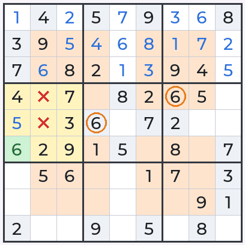

<!-- Written by tools/walkthrough.py hyper: edit the script, not this page. -->
# Hyper, step 18: the 6 in box 4

**Step 18 of 43** · [← Step 17](step-17.md) · [All steps](../hyper.md#the-whole-puzzle-step-by-step) · [Step 19 →](step-19.md)

Box 4 needs a 6. r4c2: row 4 has one (r4c7). r5c2: row 5 has one (r5c4). Only **r6c1** is left: **r6c1 = 6**.

**Step 18 of 43** · [← Step 17](step-17.md) · [All steps](../hyper.md#the-whole-puzzle-step-by-step) · [Step 19 →](step-19.md)
