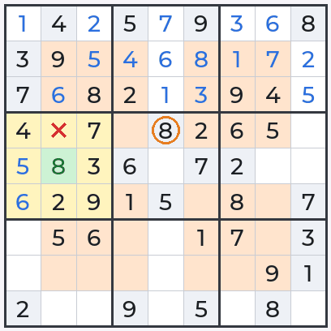

<!-- Written by tools/walkthrough.py hyper: edit the script, not this page. -->
# Hyper, step 19: the 8 in box 4

**Step 19 of 43** · [← Step 18](step-18.md) · [All steps](../hyper.md#the-whole-puzzle-step-by-step) · [Step 20 →](step-20.md)

Box 4 needs an 8. r4c2: row 4 has one (r4c5). Only **r5c2** is left: **r5c2 = 8**.

**Step 19 of 43** · [← Step 18](step-18.md) · [All steps](../hyper.md#the-whole-puzzle-step-by-step) · [Step 20 →](step-20.md)
