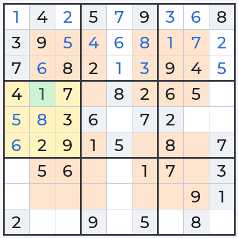

<!-- Written by tools/walkthrough.py hyper: edit the script, not this page. -->
# Hyper, step 20: the 1 in box 4

**Step 20 of 43** · [← Step 19](step-19.md) · [All steps](../hyper.md#the-whole-puzzle-step-by-step) · [Step 21 →](step-21.md)

Box 4 needs a 1, and r4c2 is its last empty cell: **r4c2 = 1**.

**Step 20 of 43** · [← Step 19](step-19.md) · [All steps](../hyper.md#the-whole-puzzle-step-by-step) · [Step 21 →](step-21.md)
