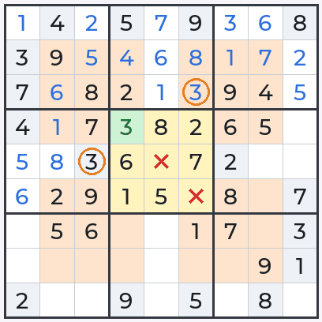

<!-- Written by tools/walkthrough.py hyper: edit the script, not this page. -->
# Hyper, step 21: the 3 in box 5

**Step 21 of 43** · [← Step 20](step-20.md) · [All steps](../hyper.md#the-whole-puzzle-step-by-step) · [Step 22 →](step-22.md)

Box 5 needs a 3. r5c5: row 5 has one (r5c3). r6c6: column 6 has one (r3c6). Only **r4c4** is left: **r4c4 = 3**.

**Step 21 of 43** · [← Step 20](step-20.md) · [All steps](../hyper.md#the-whole-puzzle-step-by-step) · [Step 22 →](step-22.md)
