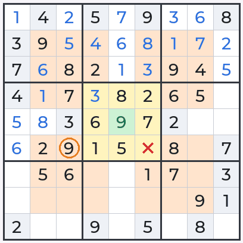

<!-- Written by tools/walkthrough.py hyper: edit the script, not this page. -->
# Hyper, step 22: the 9 in box 5

**Step 22 of 43** · [← Step 21](step-21.md) · [All steps](../hyper.md#the-whole-puzzle-step-by-step) · [Step 23 →](step-23.md)

Box 5 needs a 9. r6c6: row 6 has one (r6c3). Only **r5c5** is left: **r5c5 = 9**.

**Step 22 of 43** · [← Step 21](step-21.md) · [All steps](../hyper.md#the-whole-puzzle-step-by-step) · [Step 23 →](step-23.md)
