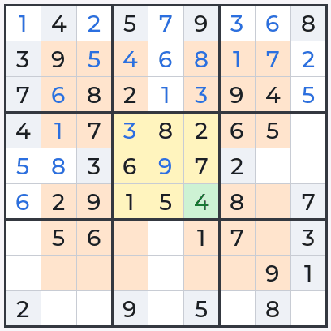

<!-- Written by tools/walkthrough.py hyper: edit the script, not this page. -->
# Hyper, step 23: the 4 in box 5

**Step 23 of 43** · [← Step 22](step-22.md) · [All steps](../hyper.md#the-whole-puzzle-step-by-step) · [Step 24 →](step-24.md)

Box 5 needs a 4, and r6c6 is its last empty cell: **r6c6 = 4**.

**Step 23 of 43** · [← Step 22](step-22.md) · [All steps](../hyper.md#the-whole-puzzle-step-by-step) · [Step 24 →](step-24.md)
