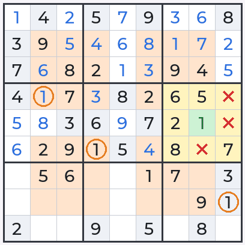

<!-- Written by tools/walkthrough.py hyper: edit the script, not this page. -->
# Hyper, step 24: the 1 in box 6

**Step 24 of 43** · [← Step 23](step-23.md) · [All steps](../hyper.md#the-whole-puzzle-step-by-step) · [Step 25 →](step-25.md)

Box 6 needs a 1. r4c9: row 4 has one (r4c2). r5c9: column 9 has one (r8c9). r6c8: row 6 has one (r6c4). Only **r5c8** is left: **r5c8 = 1**.

**Step 24 of 43** · [← Step 23](step-23.md) · [All steps](../hyper.md#the-whole-puzzle-step-by-step) · [Step 25 →](step-25.md)
