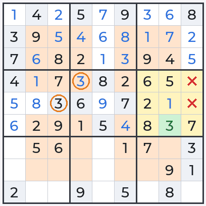

<!-- Written by tools/walkthrough.py hyper: edit the script, not this page. -->
# Hyper, step 25: the 3 in box 6

**Step 25 of 43** · [← Step 24](step-24.md) · [All steps](../hyper.md#the-whole-puzzle-step-by-step) · [Step 26 →](step-26.md)

Box 6 needs a 3. r4c9: row 4 has one (r4c4). r5c9: row 5 has one (r5c3). Only **r6c8** is left: **r6c8 = 3**.

**Step 25 of 43** · [← Step 24](step-24.md) · [All steps](../hyper.md#the-whole-puzzle-step-by-step) · [Step 26 →](step-26.md)
