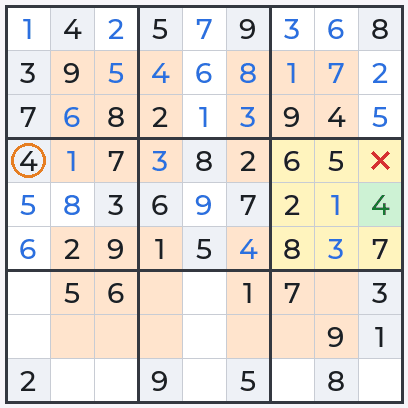

<!-- Written by tools/walkthrough.py hyper: edit the script, not this page. -->
# Hyper, step 26: the 4 in box 6

**Step 26 of 43** · [← Step 25](step-25.md) · [All steps](../hyper.md#the-whole-puzzle-step-by-step) · [Step 27 →](step-27.md)

Box 6 needs a 4. r4c9: row 4 has one (r4c1). Only **r5c9** is left: **r5c9 = 4**.

**Step 26 of 43** · [← Step 25](step-25.md) · [All steps](../hyper.md#the-whole-puzzle-step-by-step) · [Step 27 →](step-27.md)
