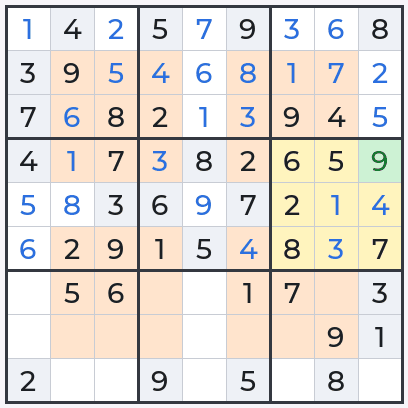

<!-- Written by tools/walkthrough.py hyper: edit the script, not this page. -->
# Hyper, step 27: the 9 in box 6

**Step 27 of 43** · [← Step 26](step-26.md) · [All steps](../hyper.md#the-whole-puzzle-step-by-step) · [Step 28 →](step-28.md)

Box 6 needs a 9, and r4c9 is its last empty cell: **r4c9 = 9**.

**Step 27 of 43** · [← Step 26](step-26.md) · [All steps](../hyper.md#the-whole-puzzle-step-by-step) · [Step 28 →](step-28.md)
