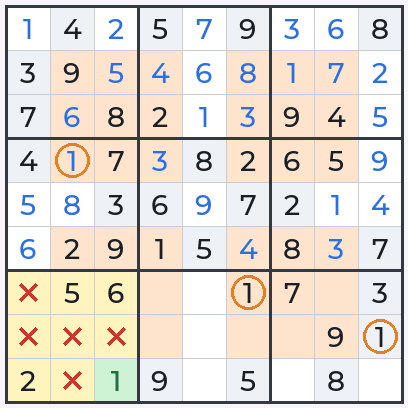

<!-- Written by tools/walkthrough.py hyper: edit the script, not this page. -->
# Hyper, step 28: the 1 in box 7

**Step 28 of 43** · [← Step 27](step-27.md) · [All steps](../hyper.md#the-whole-puzzle-step-by-step) · [Step 29 →](step-29.md)

Box 7 needs a 1. r7c1: row 7 has one (r7c6). r8c1, r8c2 and r8c3: row 8 has one (r8c9). r9c2: column 2 has one (r4c2). Only **r9c3** is left: **r9c3 = 1**.

**Step 28 of 43** · [← Step 27](step-27.md) · [All steps](../hyper.md#the-whole-puzzle-step-by-step) · [Step 29 →](step-29.md)
