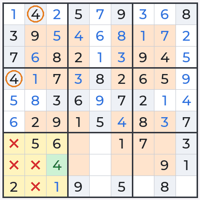

<!-- Written by tools/walkthrough.py hyper: edit the script, not this page. -->
# Hyper, step 29: the 4 in box 7

**Step 29 of 43** · [← Step 28](step-28.md) · [All steps](../hyper.md#the-whole-puzzle-step-by-step) · [Step 30 →](step-30.md)

Box 7 needs a 4. r7c1 and r8c1: column 1 has one (r4c1). r8c2 and r9c2: column 2 has one (r1c2). Only **r8c3** is left: **r8c3 = 4**.

**Step 29 of 43** · [← Step 28](step-28.md) · [All steps](../hyper.md#the-whole-puzzle-step-by-step) · [Step 30 →](step-30.md)
