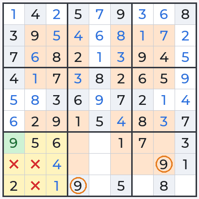

<!-- Written by tools/walkthrough.py hyper: edit the script, not this page. -->
# Hyper, step 30: the 9 in box 7

**Step 30 of 43** · [← Step 29](step-29.md) · [All steps](../hyper.md#the-whole-puzzle-step-by-step) · [Step 31 →](step-31.md)

Box 7 needs a 9. r8c1 and r8c2: row 8 has one (r8c8). r9c2: row 9 has one (r9c4). Only **r7c1** is left: **r7c1 = 9**.

**Step 30 of 43** · [← Step 29](step-29.md) · [All steps](../hyper.md#the-whole-puzzle-step-by-step) · [Step 31 →](step-31.md)
