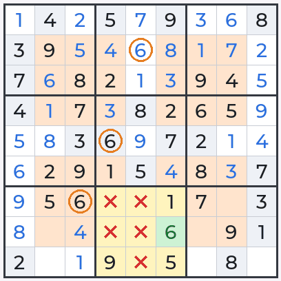

<!-- Written by tools/walkthrough.py hyper: edit the script, not this page. -->
# Hyper, step 32: the 6 in box 8

**Step 32 of 43** · [← Step 31](step-31.md) · [All steps](../hyper.md#the-whole-puzzle-step-by-step) · [Step 33 →](step-33.md)

Box 8 needs a 6. r7c4 and r7c5: row 7 has one (r7c3). r8c4: column 4 has one (r5c4). r8c5 and r9c5: column 5 has one (r2c5). Only **r8c6** is left: **r8c6 = 6**.

**Step 32 of 43** · [← Step 31](step-31.md) · [All steps](../hyper.md#the-whole-puzzle-step-by-step) · [Step 33 →](step-33.md)
