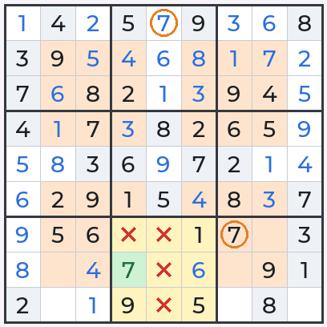

<!-- Written by tools/walkthrough.py hyper: edit the script, not this page. -->
# Hyper, step 33: the 7 in box 8

**Step 33 of 43** · [← Step 32](step-32.md) · [All steps](../hyper.md#the-whole-puzzle-step-by-step) · [Step 34 →](step-34.md)

Box 8 needs a 7. r7c4 and r7c5: row 7 has one (r7c7). r8c5 and r9c5: column 5 has one (r1c5). Only **r8c4** is left: **r8c4 = 7**.

**Step 33 of 43** · [← Step 32](step-32.md) · [All steps](../hyper.md#the-whole-puzzle-step-by-step) · [Step 34 →](step-34.md)
