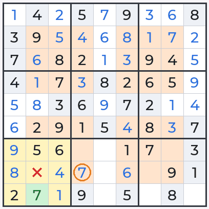

<!-- Written by tools/walkthrough.py hyper: edit the script, not this page. -->
# Hyper, step 34: the 7 in box 7

**Step 34 of 43** · [← Step 33](step-33.md) · [All steps](../hyper.md#the-whole-puzzle-step-by-step) · [Step 35 →](step-35.md)

Box 7 needs a 7. r8c2: row 8 has one (r8c4). Only **r9c2** is left: **r9c2 = 7**.

**Step 34 of 43** · [← Step 33](step-33.md) · [All steps](../hyper.md#the-whole-puzzle-step-by-step) · [Step 35 →](step-35.md)
