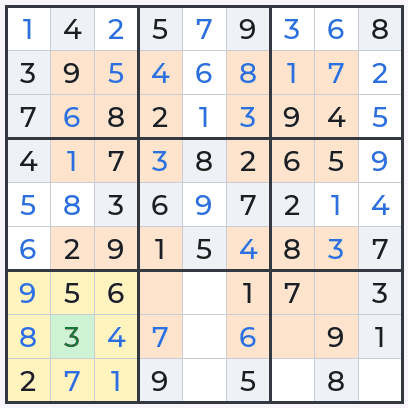

<!-- Written by tools/walkthrough.py hyper: edit the script, not this page. -->
# Hyper, step 35: the 3 in box 7

**Step 35 of 43** · [← Step 34](step-34.md) · [All steps](../hyper.md#the-whole-puzzle-step-by-step) · [Step 36 →](step-36.md)

Box 7 needs a 3, and r8c2 is its last empty cell: **r8c2 = 3**.

**Step 35 of 43** · [← Step 34](step-34.md) · [All steps](../hyper.md#the-whole-puzzle-step-by-step) · [Step 36 →](step-36.md)
