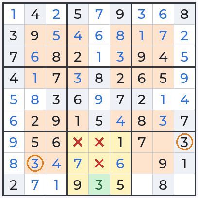

<!-- Written by tools/walkthrough.py hyper: edit the script, not this page. -->
# Hyper, step 36: the 3 in box 8

**Step 36 of 43** · [← Step 35](step-35.md) · [All steps](../hyper.md#the-whole-puzzle-step-by-step) · [Step 37 →](step-37.md)

Box 8 needs a 3. r7c4 and r7c5: row 7 has one (r7c9). r8c5: row 8 has one (r8c2). Only **r9c5** is left: **r9c5 = 3**.

**Step 36 of 43** · [← Step 35](step-35.md) · [All steps](../hyper.md#the-whole-puzzle-step-by-step) · [Step 37 →](step-37.md)
