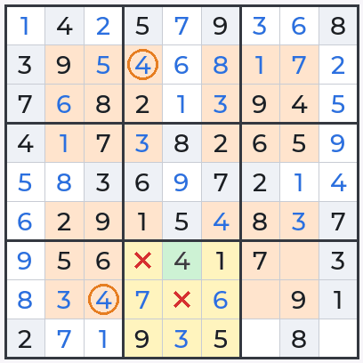

<!-- Written by tools/walkthrough.py hyper: edit the script, not this page. -->
# Hyper, step 37: the 4 in box 8

**Step 37 of 43** · [← Step 36](step-36.md) · [All steps](../hyper.md#the-whole-puzzle-step-by-step) · [Step 38 →](step-38.md)

Box 8 needs a 4. r7c4: column 4 has one (r2c4). r8c5: row 8 has one (r8c3). Only **r7c5** is left: **r7c5 = 4**.

**Step 37 of 43** · [← Step 36](step-36.md) · [All steps](../hyper.md#the-whole-puzzle-step-by-step) · [Step 38 →](step-38.md)
