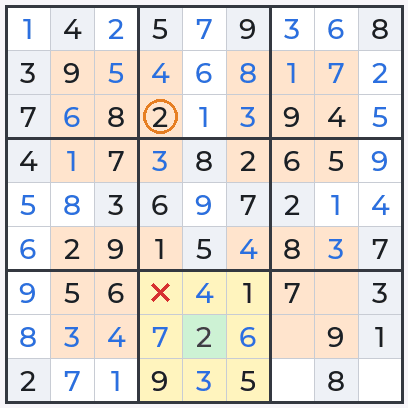

<!-- Written by tools/walkthrough.py hyper: edit the script, not this page. -->
# Hyper, step 38: the 2 in box 8

**Step 38 of 43** · [← Step 37](step-37.md) · [All steps](../hyper.md#the-whole-puzzle-step-by-step) · [Step 39 →](step-39.md)

Box 8 needs a 2. r7c4: column 4 has one (r3c4). Only **r8c5** is left: **r8c5 = 2**.

**Step 38 of 43** · [← Step 37](step-37.md) · [All steps](../hyper.md#the-whole-puzzle-step-by-step) · [Step 39 →](step-39.md)
