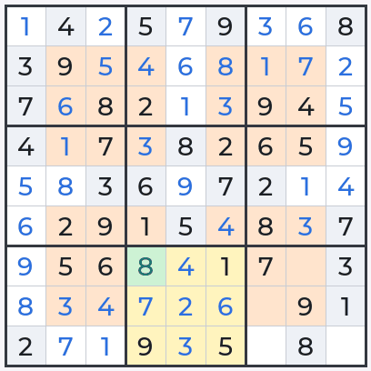

<!-- Written by tools/walkthrough.py hyper: edit the script, not this page. -->
# Hyper, step 39: the 8 in box 8

**Step 39 of 43** · [← Step 38](step-38.md) · [All steps](../hyper.md#the-whole-puzzle-step-by-step) · [Step 40 →](step-40.md)

Box 8 needs an 8, and r7c4 is its last empty cell: **r7c4 = 8**.

**Step 39 of 43** · [← Step 38](step-38.md) · [All steps](../hyper.md#the-whole-puzzle-step-by-step) · [Step 40 →](step-40.md)
