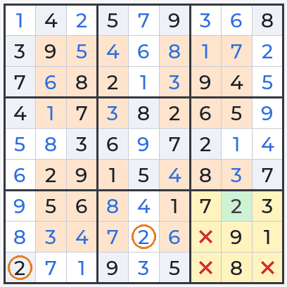

<!-- Written by tools/walkthrough.py hyper: edit the script, not this page. -->
# Hyper, step 40: the 2 in box 9

**Step 40 of 43** · [← Step 39](step-39.md) · [All steps](../hyper.md#the-whole-puzzle-step-by-step) · [Step 41 →](step-41.md)

Box 9 needs a 2. r8c7: row 8 has one (r8c5). r9c7 and r9c9: row 9 has one (r9c1). Only **r7c8** is left: **r7c8 = 2**.

**Step 40 of 43** · [← Step 39](step-39.md) · [All steps](../hyper.md#the-whole-puzzle-step-by-step) · [Step 41 →](step-41.md)
