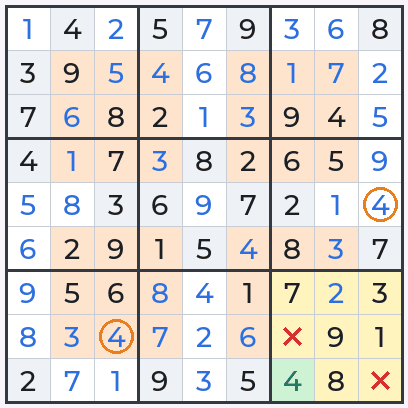

<!-- Written by tools/walkthrough.py hyper: edit the script, not this page. -->
# Hyper, step 41: the 4 in box 9

**Step 41 of 43** · [← Step 40](step-40.md) · [All steps](../hyper.md#the-whole-puzzle-step-by-step) · [Step 42 →](step-42.md)

Box 9 needs a 4. r8c7: row 8 has one (r8c3). r9c9: column 9 has one (r5c9). Only **r9c7** is left: **r9c7 = 4**.

**Step 41 of 43** · [← Step 40](step-40.md) · [All steps](../hyper.md#the-whole-puzzle-step-by-step) · [Step 42 →](step-42.md)
