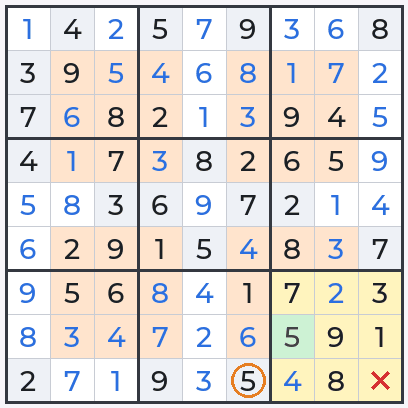

<!-- Written by tools/walkthrough.py hyper: edit the script, not this page. -->
# Hyper, step 42: the 5 in box 9

**Step 42 of 43** · [← Step 41](step-41.md) · [All steps](../hyper.md#the-whole-puzzle-step-by-step) · [Step 43 →](step-43.md)

Box 9 needs a 5. r9c9: row 9 has one (r9c6). Only **r8c7** is left: **r8c7 = 5**.

**Step 42 of 43** · [← Step 41](step-41.md) · [All steps](../hyper.md#the-whole-puzzle-step-by-step) · [Step 43 →](step-43.md)
