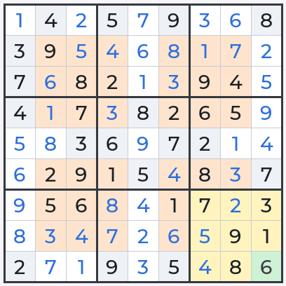

<!-- Written by tools/walkthrough.py hyper: edit the script, not this page. -->
# Hyper, step 43: the 6 in box 9

**Step 43 of 43** · [← Step 42](step-42.md) · [All steps](../hyper.md#the-whole-puzzle-step-by-step) · [All steps](../hyper.md#the-whole-puzzle-step-by-step)

Box 9 needs a 6, and r9c9 is its last empty cell: **r9c9 = 6**.

Solved.

**Step 43 of 43** · [← Step 42](step-42.md) · [All steps](../hyper.md#the-whole-puzzle-step-by-step) · [All steps](../hyper.md#the-whole-puzzle-step-by-step)
