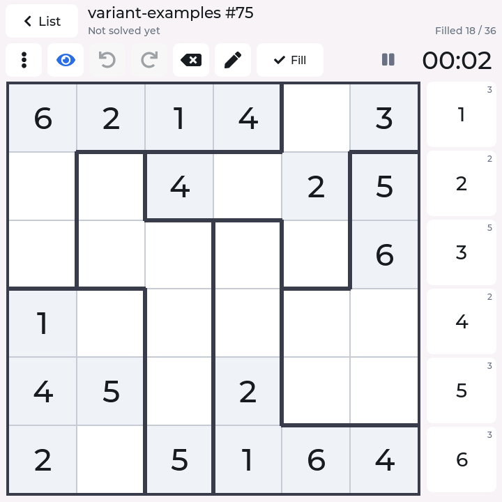
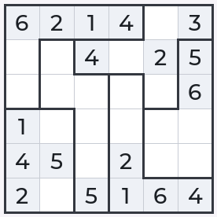

# Jigsaw 6×6

[← All variants](README.md) · [Puzzles](../features-puzzles.md) · [How to play](../how-to-play.md)

## The rules

A 6×6 grid with the digits 1 to 6: every **row**, every **column** and every **region** holds 1 to 6, each once. Instead of [Mini 6×6](mini-6x6.md)'s 2×3 boxes, the six regions are **irregular shapes** of six connected cells, outlined with thick lines, as in [Jigsaw](jigsaw.md). Every puzzle has its own regions.

## On the board

- A six-key number pad and larger cells; the regions are drawn with thick borders, as Jigsaw's.
- Hints call the regions "region 1" to "region 6".
- **Puzzles → ⋮ → New puzzle → Grids → Jigsaw 6x6**, at all four levels. Easy keeps 16 or more of the 36 cells. The regions are made by reshaping the 2×3 boxes, cell by cell, and drawn again while one still has five or six cells in a row or column.

## How to solve it

- The same steps as [Jigsaw](jigsaw.md): look for **hidden singles** region by region, then in the rows and columns.
- With only six digits, **naked singles** come quickly: a cell whose row, column and region already show five different digits has one left.
- A region that reaches into a row or column takes its digits away from the rest of that line, wherever they sit in the region.

## Worked example

**variant-examples #75**, Jigsaw 6×6 Easy (see [Classic](classic.md#worked-example-the-whole-puzzle) for how to import the examples; cells are written r*row*c*column*).

**Step 1: r2c4.** Row 2 has 4, 2 and 5; its region has the 3 in r1c6; column 4 has the 1 in r6c4. Only 6 is left: **r2c4 = 6**.

**Step 2: the 4 in row 3.** Columns 1, 3 and 4 have a 4 (r5c1, r2c3, r1c4), r3c5 shares its region with the 4 in r2c3, and r3c6 holds the 6. **r3c2 = 4**.

**Step 3: the 5 in row 4.** Columns 2 and 3 have a 5 (r5c2, r6c3), and the 5 in r2c6 rules out r4c6 (its column) and r4c5 (its region). **r4c4 = 5**.

## The whole puzzle, step by step

<!-- walkthrough -->
<!-- Written by tools/walkthrough.py jigsaw-6x6: edit the script, not this part. -->

The whole puzzle, from the start to the last cell: 18 steps, each one a single (one place left for a digit, or one digit left for a cell), taken in the order a box's single comes first, so not quite the order of the worked example above. Each step has a page of its own, with **Previous** and **Next**: pick its number below. In each picture, the unit the step looks at is tinted yellow (for a cell with one digit left: its row, column and box), the new digit is on green, the digits that rule cells out have an **orange ring**, and the empty cells they rule out a **red cross**. Givens are on grey, digits from earlier steps in blue.

| [1](jigsaw-6x6/step-01.md) | [2](jigsaw-6x6/step-02.md) | [3](jigsaw-6x6/step-03.md) | [4](jigsaw-6x6/step-04.md) | [5](jigsaw-6x6/step-05.md) | [6](jigsaw-6x6/step-06.md) | [7](jigsaw-6x6/step-07.md) | [8](jigsaw-6x6/step-08.md) | [9](jigsaw-6x6/step-09.md) | [10](jigsaw-6x6/step-10.md) |
|:-:|:-:|:-:|:-:|:-:|:-:|:-:|:-:|:-:|:-:|
| [11](jigsaw-6x6/step-11.md) | [12](jigsaw-6x6/step-12.md) | [13](jigsaw-6x6/step-13.md) | [14](jigsaw-6x6/step-14.md) | [15](jigsaw-6x6/step-15.md) | [16](jigsaw-6x6/step-16.md) | [17](jigsaw-6x6/step-17.md) | [18](jigsaw-6x6/step-18.md) |  |  |

Solved.

<!-- /walkthrough -->
