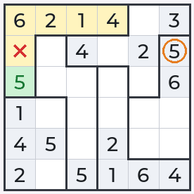

<!-- Written by tools/walkthrough.py jigsaw-6x6: edit the script, not this page. -->
# Jigsaw 6x6, step 1: the 5 in region 1

**Step 1 of 18** · [← The start](../jigsaw-6x6.md#the-whole-puzzle-step-by-step) · [All steps](../jigsaw-6x6.md#the-whole-puzzle-step-by-step) · [Step 2 →](step-02.md)

Region 1 needs a 5. r2c1: row 2 has one (r2c6). Only **r3c1** is left: **r3c1 = 5**.

**Step 1 of 18** · [← The start](../jigsaw-6x6.md#the-whole-puzzle-step-by-step) · [All steps](../jigsaw-6x6.md#the-whole-puzzle-step-by-step) · [Step 2 →](step-02.md)
