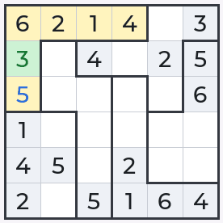

<!-- Written by tools/walkthrough.py jigsaw-6x6: edit the script, not this page. -->
# Jigsaw 6x6, step 2: the 3 in region 1

**Step 2 of 18** · [← Step 1](step-01.md) · [All steps](../jigsaw-6x6.md#the-whole-puzzle-step-by-step) · [Step 3 →](step-03.md)

Region 1 needs a 3, and r2c1 is its last empty cell: **r2c1 = 3**.

**Step 2 of 18** · [← Step 1](step-01.md) · [All steps](../jigsaw-6x6.md#the-whole-puzzle-step-by-step) · [Step 3 →](step-03.md)
