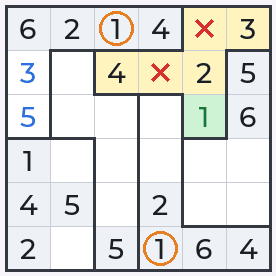

<!-- Written by tools/walkthrough.py jigsaw-6x6: edit the script, not this page. -->
# Jigsaw 6x6, step 3: the 1 in region 2

**Step 3 of 18** · [← Step 2](step-02.md) · [All steps](../jigsaw-6x6.md#the-whole-puzzle-step-by-step) · [Step 4 →](step-04.md)

Region 2 needs a 1. r1c5: row 1 has one (r1c3). r2c4: column 4 has one (r6c4). Only **r3c5** is left: **r3c5 = 1**.

**Step 3 of 18** · [← Step 2](step-02.md) · [All steps](../jigsaw-6x6.md#the-whole-puzzle-step-by-step) · [Step 4 →](step-04.md)
