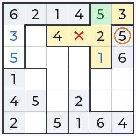

<!-- Written by tools/walkthrough.py jigsaw-6x6: edit the script, not this page. -->
# Jigsaw 6x6, step 4: the 5 in region 2

**Step 4 of 18** · [← Step 3](step-03.md) · [All steps](../jigsaw-6x6.md#the-whole-puzzle-step-by-step) · [Step 5 →](step-05.md)

Region 2 needs a 5. r2c4: row 2 has one (r2c6). Only **r1c5** is left: **r1c5 = 5**.

**Step 4 of 18** · [← Step 3](step-03.md) · [All steps](../jigsaw-6x6.md#the-whole-puzzle-step-by-step) · [Step 5 →](step-05.md)
