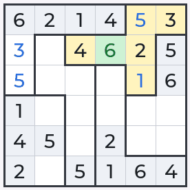

<!-- Written by tools/walkthrough.py jigsaw-6x6: edit the script, not this page. -->
# Jigsaw 6x6, step 5: the 6 in region 2

**Step 5 of 18** · [← Step 4](step-04.md) · [All steps](../jigsaw-6x6.md#the-whole-puzzle-step-by-step) · [Step 6 →](step-06.md)

Region 2 needs a 6, and r2c4 is its last empty cell: **r2c4 = 6**.

**Step 5 of 18** · [← Step 4](step-04.md) · [All steps](../jigsaw-6x6.md#the-whole-puzzle-step-by-step) · [Step 6 →](step-06.md)
