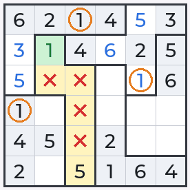

<!-- Written by tools/walkthrough.py jigsaw-6x6: edit the script, not this page. -->
# Jigsaw 6x6, step 6: the 1 in region 3

**Step 6 of 18** · [← Step 5](step-05.md) · [All steps](../jigsaw-6x6.md#the-whole-puzzle-step-by-step) · [Step 7 →](step-07.md)

Region 3 needs a 1. r3c2 and r3c3: row 3 has one (r3c5). r4c3: row 4 has one (r4c1). r5c3: column 3 has one (r1c3). Only **r2c2** is left: **r2c2 = 1**.

**Step 6 of 18** · [← Step 5](step-05.md) · [All steps](../jigsaw-6x6.md#the-whole-puzzle-step-by-step) · [Step 7 →](step-07.md)
