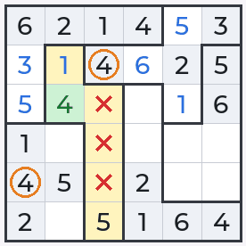

<!-- Written by tools/walkthrough.py jigsaw-6x6: edit the script, not this page. -->
# Jigsaw 6x6, step 7: the 4 in region 3

**Step 7 of 18** · [← Step 6](step-06.md) · [All steps](../jigsaw-6x6.md#the-whole-puzzle-step-by-step) · [Step 8 →](step-08.md)

Region 3 needs a 4. r3c3 and r4c3: column 3 has one (r2c3). r5c3: row 5 has one (r5c1). Only **r3c2** is left: **r3c2 = 4**.

**Step 7 of 18** · [← Step 6](step-06.md) · [All steps](../jigsaw-6x6.md#the-whole-puzzle-step-by-step) · [Step 8 →](step-08.md)
