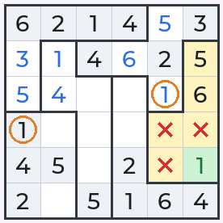

<!-- Written by tools/walkthrough.py jigsaw-6x6: edit the script, not this page. -->
# Jigsaw 6x6, step 8: the 1 in region 4

**Step 8 of 18** · [← Step 7](step-07.md) · [All steps](../jigsaw-6x6.md#the-whole-puzzle-step-by-step) · [Step 9 →](step-09.md)

Region 4 needs a 1. r4c5 and r4c6: row 4 has one (r4c1). r5c5: column 5 has one (r3c5). Only **r5c6** is left: **r5c6 = 1**.

**Step 8 of 18** · [← Step 7](step-07.md) · [All steps](../jigsaw-6x6.md#the-whole-puzzle-step-by-step) · [Step 9 →](step-09.md)
