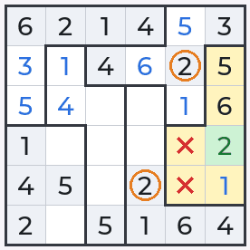

<!-- Written by tools/walkthrough.py jigsaw-6x6: edit the script, not this page. -->
# Jigsaw 6x6, step 9: the 2 in region 4

**Step 9 of 18** · [← Step 8](step-08.md) · [All steps](../jigsaw-6x6.md#the-whole-puzzle-step-by-step) · [Step 10 →](step-10.md)

Region 4 needs a 2. r4c5: column 5 has one (r2c5). r5c5: row 5 has one (r5c4). Only **r4c6** is left: **r4c6 = 2**.

**Step 9 of 18** · [← Step 8](step-08.md) · [All steps](../jigsaw-6x6.md#the-whole-puzzle-step-by-step) · [Step 10 →](step-10.md)
