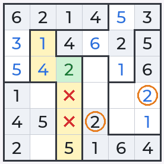

<!-- Written by tools/walkthrough.py jigsaw-6x6: edit the script, not this page. -->
# Jigsaw 6x6, step 10: the 2 in region 3

**Step 10 of 18** · [← Step 9](step-09.md) · [All steps](../jigsaw-6x6.md#the-whole-puzzle-step-by-step) · [Step 11 →](step-11.md)

Region 3 needs a 2. r4c3: row 4 has one (r4c6). r5c3: row 5 has one (r5c4). Only **r3c3** is left: **r3c3 = 2**.

**Step 10 of 18** · [← Step 9](step-09.md) · [All steps](../jigsaw-6x6.md#the-whole-puzzle-step-by-step) · [Step 11 →](step-11.md)
