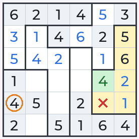

<!-- Written by tools/walkthrough.py jigsaw-6x6: edit the script, not this page. -->
# Jigsaw 6x6, step 11: the 4 in region 4

**Step 11 of 18** · [← Step 10](step-10.md) · [All steps](../jigsaw-6x6.md#the-whole-puzzle-step-by-step) · [Step 12 →](step-12.md)

Region 4 needs a 4. r5c5: row 5 has one (r5c1). Only **r4c5** is left: **r4c5 = 4**.

**Step 11 of 18** · [← Step 10](step-10.md) · [All steps](../jigsaw-6x6.md#the-whole-puzzle-step-by-step) · [Step 12 →](step-12.md)
