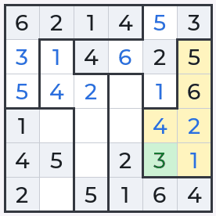

<!-- Written by tools/walkthrough.py jigsaw-6x6: edit the script, not this page. -->
# Jigsaw 6x6, step 12: the 3 in region 4

**Step 12 of 18** · [← Step 11](step-11.md) · [All steps](../jigsaw-6x6.md#the-whole-puzzle-step-by-step) · [Step 13 →](step-13.md)

Region 4 needs a 3, and r5c5 is its last empty cell: **r5c5 = 3**.

**Step 12 of 18** · [← Step 11](step-11.md) · [All steps](../jigsaw-6x6.md#the-whole-puzzle-step-by-step) · [Step 13 →](step-13.md)
