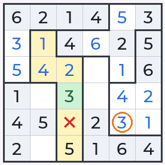

<!-- Written by tools/walkthrough.py jigsaw-6x6: edit the script, not this page. -->
# Jigsaw 6x6, step 13: the 3 in region 3

**Step 13 of 18** · [← Step 12](step-12.md) · [All steps](../jigsaw-6x6.md#the-whole-puzzle-step-by-step) · [Step 14 →](step-14.md)

Region 3 needs a 3. r5c3: row 5 has one (r5c5). Only **r4c3** is left: **r4c3 = 3**.

**Step 13 of 18** · [← Step 12](step-12.md) · [All steps](../jigsaw-6x6.md#the-whole-puzzle-step-by-step) · [Step 14 →](step-14.md)
