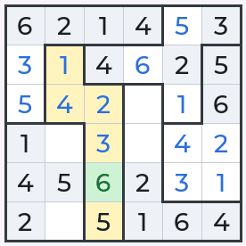

<!-- Written by tools/walkthrough.py jigsaw-6x6: edit the script, not this page. -->
# Jigsaw 6x6, step 14: the 6 in region 3

**Step 14 of 18** · [← Step 13](step-13.md) · [All steps](../jigsaw-6x6.md#the-whole-puzzle-step-by-step) · [Step 15 →](step-15.md)

Region 3 needs a 6, and r5c3 is its last empty cell: **r5c3 = 6**.

**Step 14 of 18** · [← Step 13](step-13.md) · [All steps](../jigsaw-6x6.md#the-whole-puzzle-step-by-step) · [Step 15 →](step-15.md)
