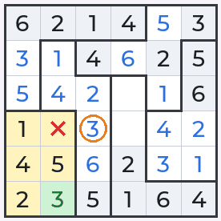

<!-- Written by tools/walkthrough.py jigsaw-6x6: edit the script, not this page. -->
# Jigsaw 6x6, step 15: the 3 in region 5

**Step 15 of 18** · [← Step 14](step-14.md) · [All steps](../jigsaw-6x6.md#the-whole-puzzle-step-by-step) · [Step 16 →](step-16.md)

Region 5 needs a 3. r4c2: row 4 has one (r4c3). Only **r6c2** is left: **r6c2 = 3**.

**Step 15 of 18** · [← Step 14](step-14.md) · [All steps](../jigsaw-6x6.md#the-whole-puzzle-step-by-step) · [Step 16 →](step-16.md)
