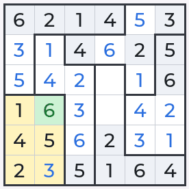

<!-- Written by tools/walkthrough.py jigsaw-6x6: edit the script, not this page. -->
# Jigsaw 6x6, step 16: the 6 in region 5

**Step 16 of 18** · [← Step 15](step-15.md) · [All steps](../jigsaw-6x6.md#the-whole-puzzle-step-by-step) · [Step 17 →](step-17.md)

Region 5 needs a 6, and r4c2 is its last empty cell: **r4c2 = 6**.

**Step 16 of 18** · [← Step 15](step-15.md) · [All steps](../jigsaw-6x6.md#the-whole-puzzle-step-by-step) · [Step 17 →](step-17.md)
