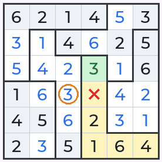

<!-- Written by tools/walkthrough.py jigsaw-6x6: edit the script, not this page. -->
# Jigsaw 6x6, step 17: the 3 in region 6

**Step 17 of 18** · [← Step 16](step-16.md) · [All steps](../jigsaw-6x6.md#the-whole-puzzle-step-by-step) · [Step 18 →](step-18.md)

Region 6 needs a 3. r4c4: row 4 has one (r4c3). Only **r3c4** is left: **r3c4 = 3**.

**Step 17 of 18** · [← Step 16](step-16.md) · [All steps](../jigsaw-6x6.md#the-whole-puzzle-step-by-step) · [Step 18 →](step-18.md)
