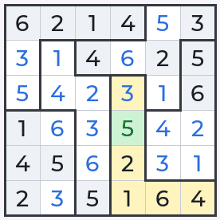

<!-- Written by tools/walkthrough.py jigsaw-6x6: edit the script, not this page. -->
# Jigsaw 6x6, step 18: the 5 in region 6

**Step 18 of 18** · [← Step 17](step-17.md) · [All steps](../jigsaw-6x6.md#the-whole-puzzle-step-by-step) · [All steps](../jigsaw-6x6.md#the-whole-puzzle-step-by-step)

Region 6 needs a 5, and r4c4 is its last empty cell: **r4c4 = 5**.

Solved.

**Step 18 of 18** · [← Step 17](step-17.md) · [All steps](../jigsaw-6x6.md#the-whole-puzzle-step-by-step) · [All steps](../jigsaw-6x6.md#the-whole-puzzle-step-by-step)
