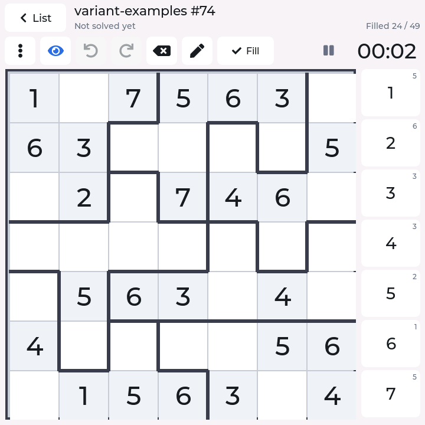
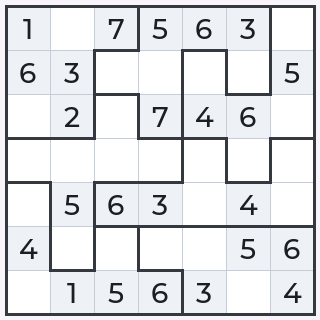

# Jigsaw 7×7

[← All variants](README.md) · [Puzzles](../features-puzzles.md) · [How to play](../how-to-play.md)

## The rules

A 7×7 grid with the digits 1 to 7: every **row**, every **column** and every **region** holds 1 to 7, each once. 7 can't be split into rectangular boxes, so the seven regions are **irregular shapes** of seven connected cells, outlined with thick lines, as in [Jigsaw](jigsaw.md). Every puzzle has its own regions.

## On the board

- A seven-key number pad and larger cells; the regions are drawn with thick borders, as Jigsaw's.
- Hints call the regions "region 1" to "region 7".
- **Puzzles → ⋮ → New puzzle → Grids → Jigsaw 7x7**, at all four levels. Easy keeps 22 or more of the 49 cells. The regions are made by reshaping the seven rows, cell by cell, and drawn again while one still has six or seven cells in a row or column.

## How to solve it

- The same steps as [Jigsaw](jigsaw.md): look for **hidden singles** region by region, then in the rows and columns.
- A region's odd shape is a tool: a digit placed in one of its cells rules it out of cells far from it in the same region, and a region that reaches into a row or column takes a digit away from the rest of that line.
- **Count across lines:** any two rows hold 1-7 twice. Where a region lies wholly inside two rows, the other regions crossing those rows have to make up the rest.

## Worked example

**variant-examples #74**, Jigsaw 7×7 Easy (see [Classic](classic.md#worked-example-the-whole-puzzle) for how to import the examples; cells are written r*row*c*column*).

**Step 1: the 7 in row 2.** Row 2 reads 6, 3, ., ., ., ., 5. Column 3 has a 7 (r1c3) and column 4 one (r3c4), so neither r2c3 nor r2c4 can take it; r2c6 shares its region with r3c4, so not there either. **r2c5 = 7**.

**Step 2: the 3 in column 1.** Column 1 has 1, 6 and 4 (rows 1, 2 and 6). r3c1 shares its region with the 3 in r2c2; rows 5 and 7 have a 3 (r5c4, r7c5). **r4c1 = 3**.

**Step 3: r3c3.** Row 3 has 2, 7, 4 and 6; column 3 has the 5 (r7c3); its region has the 3 just placed in r4c1. **r3c3 = 1**.

## The whole puzzle, step by step

<!-- walkthrough -->
<!-- Written by tools/walkthrough.py jigsaw-7x7: edit the script, not this part. -->

The whole puzzle, from the start to the last cell: 25 steps, each one a single (one place left for a digit, or one digit left for a cell), taken in the order a box's single comes first, so not quite the order of the worked example above. Each step has a page of its own, with **Previous** and **Next**: pick its number below. In each picture, the unit the step looks at is tinted yellow (for a cell with one digit left: its row, column and box), the new digit is on green, the digits that rule cells out have an **orange ring**, and the empty cells they rule out a **red cross**. Givens are on grey, digits from earlier steps in blue.

| [1](jigsaw-7x7/step-01.md) | [2](jigsaw-7x7/step-02.md) | [3](jigsaw-7x7/step-03.md) | [4](jigsaw-7x7/step-04.md) | [5](jigsaw-7x7/step-05.md) | [6](jigsaw-7x7/step-06.md) | [7](jigsaw-7x7/step-07.md) | [8](jigsaw-7x7/step-08.md) | [9](jigsaw-7x7/step-09.md) | [10](jigsaw-7x7/step-10.md) |
|:-:|:-:|:-:|:-:|:-:|:-:|:-:|:-:|:-:|:-:|
| [11](jigsaw-7x7/step-11.md) | [12](jigsaw-7x7/step-12.md) | [13](jigsaw-7x7/step-13.md) | [14](jigsaw-7x7/step-14.md) | [15](jigsaw-7x7/step-15.md) | [16](jigsaw-7x7/step-16.md) | [17](jigsaw-7x7/step-17.md) | [18](jigsaw-7x7/step-18.md) | [19](jigsaw-7x7/step-19.md) | [20](jigsaw-7x7/step-20.md) |
| [21](jigsaw-7x7/step-21.md) | [22](jigsaw-7x7/step-22.md) | [23](jigsaw-7x7/step-23.md) | [24](jigsaw-7x7/step-24.md) | [25](jigsaw-7x7/step-25.md) |  |  |  |  |  |

Solved.

<!-- /walkthrough -->
