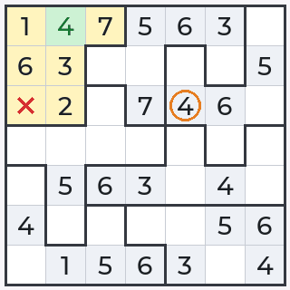

<!-- Written by tools/walkthrough.py jigsaw-7x7: edit the script, not this page. -->
# Jigsaw 7x7, step 1: the 4 in region 1

**Step 1 of 25** · [← The start](../jigsaw-7x7.md#the-whole-puzzle-step-by-step) · [All steps](../jigsaw-7x7.md#the-whole-puzzle-step-by-step) · [Step 2 →](step-02.md)

Region 1 needs a 4. r3c1: row 3 has one (r3c5). Only **r1c2** is left: **r1c2 = 4**.

**Step 1 of 25** · [← The start](../jigsaw-7x7.md#the-whole-puzzle-step-by-step) · [All steps](../jigsaw-7x7.md#the-whole-puzzle-step-by-step) · [Step 2 →](step-02.md)
