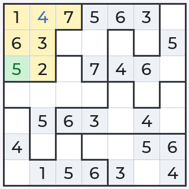

<!-- Written by tools/walkthrough.py jigsaw-7x7: edit the script, not this page. -->
# Jigsaw 7x7, step 2: the 5 in region 1

**Step 2 of 25** · [← Step 1](step-01.md) · [All steps](../jigsaw-7x7.md#the-whole-puzzle-step-by-step) · [Step 3 →](step-03.md)

Region 1 needs a 5, and r3c1 is its last empty cell: **r3c1 = 5**.

**Step 2 of 25** · [← Step 1](step-01.md) · [All steps](../jigsaw-7x7.md#the-whole-puzzle-step-by-step) · [Step 3 →](step-03.md)
