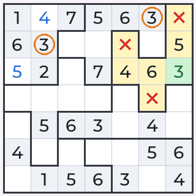

<!-- Written by tools/walkthrough.py jigsaw-7x7: edit the script, not this page. -->
# Jigsaw 7x7, step 3: the 3 in region 2

**Step 3 of 25** · [← Step 2](step-02.md) · [All steps](../jigsaw-7x7.md#the-whole-puzzle-step-by-step) · [Step 4 →](step-04.md)

Region 2 needs a 3. r1c7: row 1 has one (r1c6). r2c5: row 2 has one (r2c2). r4c6: column 6 has one (r1c6). Only **r3c7** is left: **r3c7 = 3**.

**Step 3 of 25** · [← Step 2](step-02.md) · [All steps](../jigsaw-7x7.md#the-whole-puzzle-step-by-step) · [Step 4 →](step-04.md)
