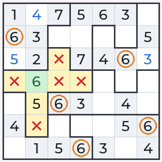

<!-- Written by tools/walkthrough.py jigsaw-7x7: edit the script, not this page. -->
# Jigsaw 7x7, step 4: the 6 in region 4

**Step 4 of 25** · [← Step 3](step-03.md) · [All steps](../jigsaw-7x7.md#the-whole-puzzle-step-by-step) · [Step 5 →](step-05.md)

Region 4 needs a 6. r3c3: row 3 has one (r3c6). r4c1: column 1 has one (r2c1). r4c3: column 3 has one (r5c3). r4c4: column 4 has one (r7c4). r6c2: row 6 has one (r6c7). Only **r4c2** is left: **r4c2 = 6**.

**Step 4 of 25** · [← Step 3](step-03.md) · [All steps](../jigsaw-7x7.md#the-whole-puzzle-step-by-step) · [Step 5 →](step-05.md)
