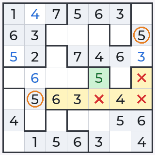

<!-- Written by tools/walkthrough.py jigsaw-7x7: edit the script, not this page. -->
# Jigsaw 7x7, step 5: the 5 in region 5

**Step 5 of 25** · [← Step 4](step-04.md) · [All steps](../jigsaw-7x7.md#the-whole-puzzle-step-by-step) · [Step 6 →](step-06.md)

Region 5 needs a 5. r4c7: column 7 has one (r2c7). r5c5 and r5c7: row 5 has one (r5c2). Only **r4c5** is left: **r4c5 = 5**.

**Step 5 of 25** · [← Step 4](step-04.md) · [All steps](../jigsaw-7x7.md#the-whole-puzzle-step-by-step) · [Step 6 →](step-06.md)
